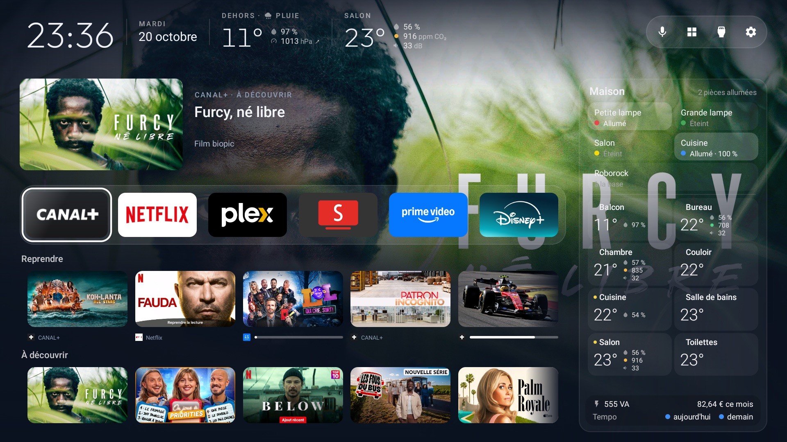

# Synéma

[English](README.md) · **Français**

Un launcher Android TV avec un tableau de bord Home Assistant, et les outils pour débarrasser une
Android TV de ses publicités et applis imposées. Conçu et testé sur une TV OLED Philips sous Android TV 11 ;
le launcher et les outils de nettoyage fonctionnent sur la plupart des Android TV et Google TV (pas
Samsung, LG ni Fire TV).



## Fonctions

- **Un accueil calme** : applis favorites et entrées HDMI, « Reprendre » et ce que chaque appli met en
  avant au même endroit, un bandeau pour le titre sélectionné (résumé, épisode, temps restant, note TMDB),
  son affiche en fond.
- **La maison** (Home Assistant, facultatif) : mesures dehors et par pièce, lumières et pièces,
  électricité, caméras en direct (WebRTC via Frigate), alertes par-dessus n'importe quelle appli, boutons
  de la télécommande qui pilotent la maison.
- **Un assistant vocal** : les phrases vont à un agent de conversation Home Assistant, qui sait aussi
  trouver et lancer un titre dans les applis.
- **Plus de publicité ni de télémétrie** : rangées sponsorisées et applis imposées désactivées, jamais
  désinstallées ; tout se restaure.
- **AirPlay** vers la TV, réglé pour la 4K ([airplay/](airplay/README.md)).

## Installation

Il faut la TV et un ordinateur sur le même réseau, Python 3, le JDK 17 et le SDK Android 34.

1. **Sur la TV** : Paramètres → Préférences de l'appareil → À propos → appuyer sept fois sur OK sur
   « Build » → retour → Options pour les développeurs → activer le **débogage USB** (et le débogage
   réseau s'il est proposé). Noter l'adresse IP de la TV (Paramètres → Réseau).
2. **Sur l'ordinateur** :

   ```bash
   git clone https://github.com/Synseria/Synema && cd Synema
   python3 -m venv tools/venv && tools/venv/bin/pip install -r tools/requirements.txt
   cp secrets.local.json.example secrets.local.json   # adresse de la TV, de Home Assistant, son jeton, celui de TMDB
   cp launcher/app/src/main/res/raw/home.json home.local.json   # puis décrire sa maison : docs/dashboard.md
   sh run.sh --install --start
   tools/secrets.sh                                   # donne ses clés au launcher
   ```

3. **Accepter** « Autoriser le débogage USB ? » sur la TV la première fois.

Les deux fichiers `*.local.json` sont ignorés par git et n'entrent jamais dans l'APK. Sans Home
Assistant, laisser la maison de côté : le launcher fonctionne comme un simple écran d'accueil.

Pour nettoyer la TV, appliquer une liste de [`examples/`](examples/) (une trentaine de TV) ou écrire
celle de la sienne ; [`PROMPT.md`](PROMPT.md) guide un assistant de code comme Claude Code pas à pas
(sauvegarde, nettoyage, launcher).

## À la main

| Commande | Ce qu'elle fait |
|---|---|
| `sh run.sh` | build debug du launcher |
| `sh run.sh --install [--start]` | l'installe comme écran d'accueil, avec le service des boutons de la télécommande et votre `home.local.json` |
| `sh build.sh` | APK release dans `dist/`, versionné d'après le dernier tag |
| `tools/disable.sh examples/<tv>/debloat.txt` | applique une liste de nettoyage ; `tools/restore.sh` l'annule |
| `tools/secrets.sh` | pousse `secrets.local.json` sur la TV |
| `tools/home.sh` | pousse `home.local.json` (la maison) sans recompiler |
| `tools/screensaver.sh 5` | économiseur d'écran après 5 minutes |

Les scripts joignent la TV à `TV_HOST`, sinon à `tv_host` dans `secrets.local.json`. Les favoris partent
de `dock_apps` dans [`config.xml`](launcher/app/src/main/res/values/config.xml), puis se modifient sur la
TV (appui long sur OK). Les problèmes connus sont dans [docs/TROUBLESHOOTING.md](docs/TROUBLESHOOTING.md).

Pour revenir à la TV d'origine :

```bash
tools/restore.sh examples/<votre-tv>/debloat.txt
```

## TMDB

This product uses the TMDB API but is not endorsed or certified by TMDB. (Ce produit utilise l'API TMDB
sans être approuvé ni certifié par TMDB.) Avec un jeton de lecture TMDB facultatif, les titres sont
complétés par les données de [TMDB](https://www.themoviedb.org) quand l'appli n'en donne pas.

## Origine et licence

Synéma est né d'un fork de [CleanYourTV](https://github.com/Gathin23/cleanyourtv) par Gathin (outils de
nettoyage, premier launcher) et a suivi sa propre voie à partir de la 3.0.0. Licence MIT, voir
[LICENSE](LICENSE).
