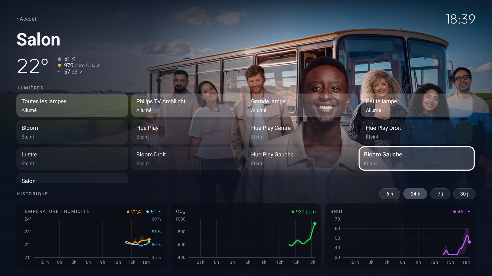
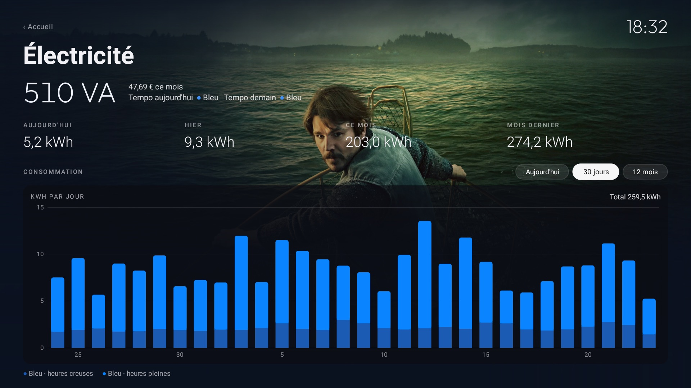
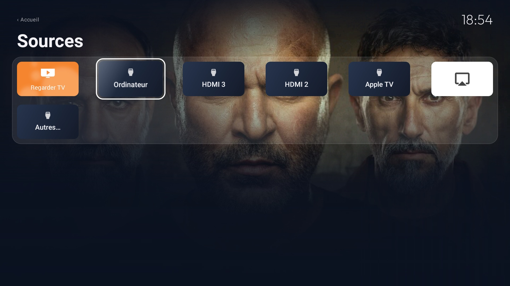

# Synéma

**English** · [Français](README.fr.md)

An Android TV launcher with a Home Assistant dashboard, and the tools to strip an Android TV of its ads
and bloat. Built and tested on a Philips OLED running Android TV 11; the launcher and the debloat tools
work on most Android TV and Google TV sets (not Samsung, LG or Fire TV).


## Features

- **A quiet home screen**: favourite apps and HDMI inputs, Continue watching and what every app puts
  forward in one place, a band for the focused title (synopsis, episode, time left, rating from TMDB),
  its artwork as the background.
- **The house** (Home Assistant, optional): outside and room readings, lights and rooms, energy, live
  cameras (WebRTC through Frigate), alerts over any app, remote buttons that drive the house.
- **A voice assistant**: sentences go to a Home Assistant conversation agent, which can also find and
  play a title from the apps.
- **No more ads or telemetry**: sponsored rows and imposed apps disabled, never uninstalled; everything
  can be restored.
- **AirPlay** to the TV, tuned for 4K ([airplay/](airplay/README.md)).

## Screens

| | |
|---|---|
|  |  |
| A room: its lights, its readings and their graphs | The electricity: power, the month's cost, Tempo, what was used |
|  | |
| Sources: the TV, each HDMI input named after its device, AirPlay | |

## Install

You need the TV and a computer on the same network, Python 3, JDK 17 and the Android SDK 34.

1. **On the TV**: Settings → Device Preferences → About → press OK on "Build" seven times → back →
   Developer options → turn on **USB debugging** (and network debugging if listed). Note the TV's IP
   address (Settings → Network).
2. **On the computer**:

   ```bash
   git clone https://github.com/Synseria/Synema && cd Synema
   python3 -m venv tools/venv && tools/venv/bin/pip install -r tools/requirements.txt
   cp secrets.local.json.example secrets.local.json   # the TV's address, Home Assistant's, its token, TMDB's
   cp launcher/app/src/main/res/raw/home.json home.local.json   # then describe your house: docs/dashboard.md
   sh run.sh --install --start
   tools/secrets.sh                                   # gives the launcher its keys
   ```

3. **Accept** "Allow USB debugging?" on the TV the first time.

Both `*.local.json` files are ignored by git and never go in the APK. Without Home Assistant, leave the
house out: the launcher works as a plain home screen.

To debloat, apply a list from [`examples/`](examples/) (about thirty TVs) or write one for yours;
[`PROMPT.md`](PROMPT.md) walks a coding assistant such as Claude Code through it (backup, debloat,
launcher).

## Doing it by hand

| Command | What it does |
|---|---|
| `sh run.sh` | debug build of the launcher |
| `sh run.sh --install [--start]` | installs it as Home, with the remote-buttons service and your `home.local.json` |
| `sh build.sh` | release APK in `dist/`, versioned from the last tag |
| `tools/disable.sh examples/<tv>/debloat.txt` | applies a debloat list; `tools/restore.sh` undoes it |
| `tools/secrets.sh` | pushes `secrets.local.json` to the TV |
| `tools/home.sh` | pushes `home.local.json` (the house) without rebuilding |
| `tools/screensaver.sh 5` | screensaver after 5 minutes |

The scripts reach the TV at `TV_HOST`, else `tv_host` in `secrets.local.json`. Favourites start from
`dock_apps` in [`config.xml`](launcher/app/src/main/res/values/config.xml), then are edited on the TV
(hold OK). Known problems are in [docs/TROUBLESHOOTING.md](docs/TROUBLESHOOTING.md).

To go back to the stock TV:

```bash
tools/restore.sh examples/<your-tv>/debloat.txt
```

## TMDB

This product uses the TMDB API but is not endorsed or certified by TMDB. With an optional TMDB read
access token, titles are completed with [TMDB](https://www.themoviedb.org)'s data where the app gives
none.

## Origin and licence

Synéma started as a fork of [CleanYourTV](https://github.com/Gathin23/cleanyourtv) by Gathin (debloat
tools, first launcher) and went its own way at 3.0.0. MIT licence, see [LICENSE](LICENSE).
